<!-- Generated design system: every graphic in assets/ui has a -dark and -light twin, switched by <picture>. -->

<a href="https://www.linkedin.com/in/suyog-sigdel-66346232a/"><picture><source media="(prefers-color-scheme: dark)" srcset="assets/ui/hero-dark.svg"></picture></a>

<picture><source media="(prefers-color-scheme: dark)" srcset="assets/ui/h-glance-dark.svg"></picture>

<picture><source media="(prefers-color-scheme: dark)" srcset="assets/ui/glance-dark.svg"></picture>

<picture><source media="(prefers-color-scheme: dark)" srcset="assets/ui/h-about-dark.svg"></picture>

<picture><source media="(prefers-color-scheme: dark)" srcset="assets/ui/about-dark.svg"></picture>

I'm a **Full Stack Developer** and **UI/UX designer** from Kathmandu, Nepal. I take a Figma design all the way to a fast, accessible production site, including the API, database and deployment behind it. I recently completed a BSc (Hons) in Computing at Islington College with First Class Honours, and I led the team that won the Islington Hackathon 2026.

<picture><source media="(prefers-color-scheme: dark)" srcset="assets/ui/h-stack-dark.svg"></picture>

<picture><source media="(prefers-color-scheme: dark)" srcset="assets/ui/stack-dark.svg"></picture>

<picture><source media="(prefers-color-scheme: dark)" srcset="assets/ui/h-wins-dark.svg"></picture>

<a href="https://caffeinated-chaos.vercel.app/"><picture><source media="(prefers-color-scheme: dark)" srcset="assets/ui/wins-dark.svg"></picture></a>

<a href="https://caffeinated-chaos.vercel.app/"><picture><source media="(prefers-color-scheme: dark)" srcset="assets/ui/btn-live-dark.svg"></picture></a> <a href="https://github.com/Suyog0-0/Caffeinated-Chaos"><picture><source media="(prefers-color-scheme: dark)" srcset="assets/ui/btn-repo-dark.svg"></picture></a>

<picture><source media="(prefers-color-scheme: dark)" srcset="assets/ui/h-projects-dark.svg"></picture>

<a href="https://caffeinated-chaos.vercel.app/"><picture><source media="(prefers-color-scheme: dark)" srcset="assets/ui/proj-caffeinated-dark.svg"></picture></a>

<a href="https://caffeinated-chaos.vercel.app/"><picture><source media="(prefers-color-scheme: dark)" srcset="assets/ui/btn-live-dark.svg"></picture></a> <a href="https://github.com/Suyog0-0/Caffeinated-Chaos"><picture><source media="(prefers-color-scheme: dark)" srcset="assets/ui/btn-repo-dark.svg"></picture></a>

<a href="https://finlaya.vercel.app/"><picture><source media="(prefers-color-scheme: dark)" srcset="assets/ui/proj-finlaya-dark.svg"></picture></a>

<a href="https://finlaya.vercel.app/"><picture><source media="(prefers-color-scheme: dark)" srcset="assets/ui/btn-live-dark.svg"></picture></a> <a href="https://github.com/Suyog0-0/FinLaya"><picture><source media="(prefers-color-scheme: dark)" srcset="assets/ui/btn-repo-dark.svg"></picture></a>

<a href="https://astha-department-frontend-five.vercel.app/"><picture><source media="(prefers-color-scheme: dark)" srcset="assets/ui/proj-aastha-dark.svg"></picture></a>

<a href="https://astha-department-frontend-five.vercel.app/"><picture><source media="(prefers-color-scheme: dark)" srcset="assets/ui/btn-live-dark.svg"></picture></a>

<a href="https://political-portfolio-five.vercel.app/"><picture><source media="(prefers-color-scheme: dark)" srcset="assets/ui/proj-renu-dark.svg"></picture></a>

<a href="https://political-portfolio-five.vercel.app/"><picture><source media="(prefers-color-scheme: dark)" srcset="assets/ui/btn-live-dark.svg"></picture></a>

<a href="https://github.com/Suyog0-0"><picture><source media="(prefers-color-scheme: dark)" srcset="assets/ui/proj-chess-dark.svg"></picture></a>

<a href="https://github.com/Suyog0-0"><picture><source media="(prefers-color-scheme: dark)" srcset="assets/ui/btn-repo-dark.svg"></picture></a>

<a href="https://www.figma.com/proto/H1sZ74o0mh58b4eSC5iUac/DajuVai-Ecom?node-id=1-3&t=o50OlUrQUaAxgrXe-1"><picture><source media="(prefers-color-scheme: dark)" srcset="assets/ui/proj-uiux-dark.svg"></picture></a>

<a href="https://www.figma.com/proto/H1sZ74o0mh58b4eSC5iUac/DajuVai-Ecom?node-id=1-3&t=o50OlUrQUaAxgrXe-1"><picture><source media="(prefers-color-scheme: dark)" srcset="assets/ui/btn-figma-dark.svg"></picture></a>

<picture><source media="(prefers-color-scheme: dark)" srcset="assets/ui/h-exp-dark.svg"></picture>

<picture><source media="(prefers-color-scheme: dark)" srcset="assets/ui/experience-dark.svg"></picture>

<picture><source media="(prefers-color-scheme: dark)" srcset="assets/ui/h-edu-dark.svg"></picture>

<picture><source media="(prefers-color-scheme: dark)" srcset="assets/ui/education-dark.svg"></picture>

<picture><source media="(prefers-color-scheme: dark)" srcset="assets/ui/h-certs-dark.svg"></picture>

#### Amazon Web Services

  <a href="https://www.credly.com/badges/8b199ae6-5d7e-42f4-b5cc-c442f6f8807e/linked_in_profile">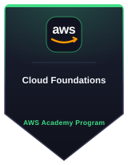</a>
  
  <a href="https://www.credly.com/badges/c400697c-40fb-4af9-989b-25524077f570/linked_in_profile">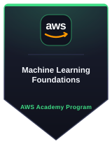</a>
  <a href="https://www.credly.com/badges/4c40bace-06f4-4954-ace2-7b0cbdd8169d/linked_in_profile">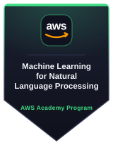</a>
  <a href="https://www.credly.com/badges/a41288ec-0504-4fce-841d-c3a3fb9a86fa/linked_in_profile">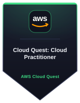</a>

#### Other

  
  
  

<picture><source media="(prefers-color-scheme: dark)" srcset="assets/ui/h-now-dark.svg"></picture>

<picture><source media="(prefers-color-scheme: dark)" srcset="assets/ui/now-dark.svg"></picture>

<picture><source media="(prefers-color-scheme: dark)" srcset="assets/ui/h-activity-dark.svg"></picture>

<picture><source media="(prefers-color-scheme: dark)" srcset="https://streak-stats.demolab.com?user=Suyog0-0&theme=radical&hide_border=true&border_radius=14&background=00000000"></picture>

<picture><source media="(prefers-color-scheme: dark)" srcset="https://github-readme-activity-graph.vercel.app/graph?username=Suyog0-0&theme=redical&hide_border=true&area=true&radius=10"></picture>

<picture><source media="(prefers-color-scheme: dark)" srcset="https://raw.githubusercontent.com/Suyog0-0/Suyog0-0/output/github-snake-dark.svg"></picture>

<picture><source media="(prefers-color-scheme: dark)" srcset="assets/ui/h-connect-dark.svg"></picture>

<a href="https://www.linkedin.com/in/suyog-sigdel-66346232a/"><picture><source media="(prefers-color-scheme: dark)" srcset="assets/ui/connect-linkedin-dark.svg"></picture></a> <a href="https://github.com/Suyog0-0"><picture><source media="(prefers-color-scheme: dark)" srcset="assets/ui/connect-github-dark.svg"></picture></a> <a href="mailto:suyogsigdelnp@gmail.com"><picture><source media="(prefers-color-scheme: dark)" srcset="assets/ui/connect-email-dark.svg"></picture></a>

<picture><source media="(prefers-color-scheme: dark)" srcset="assets/ui/footer-dark.svg"></picture>

