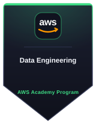
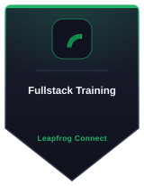
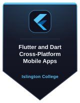
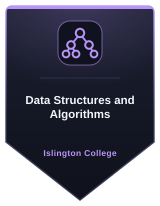

<!-- ============================================================
     HEADER — animated wave + typing SVG
     ============================================================ -->

---

<!-- ============================================================
     ABOUT ME
     ============================================================ -->

 

I'm a **Full Stack Developer** and **Computing student** at Islington College, Nepal, passionate about turning Figma designs into fast, pixel-perfect web experiences.

%20Computing%20·%20First%20Class-1a1a2e?style=flat-square&logo=googlescholar&logoColor=white) Cloud, Networking, Web Dev & more

 I go from mockup to prod faster than most

 Always expanding the stack

 Based in Nepal

 

---

<!-- ============================================================
     TECH STACK
     ============================================================ -->

## Tech Stack

<table>
  <tr>
    <td><strong>Frontend</strong></td>
    <td>
      
    </td>
  </tr>
  <tr>
    <td><strong>Backend</strong></td>
    <td>
      
    </td>
  </tr>
  <tr>
    <td><strong>Mobile</strong></td>
    <td>
      
    </td>
  </tr>
  <tr>
    <td><strong>Languages</strong></td>
    <td>
      
    </td>
  </tr>
  <tr>
    <td><strong>Design & Tools</strong></td>
    <td>
      
    </td>
  </tr>
  <tr>
    <td><strong>DevOps & Cloud</strong></td>
    <td>
      
    </td>
  </tr>
</table>

---

<!-- ============================================================
     ACHIEVEMENTS
     ============================================================ -->

## Achievements

<table>
<tr>
<td width="100%" valign="top">

**Next.js · Supabase · Team Lead**

Led the team behind **Caffeinated Chaos**, an R&D Digital Hub for Islington College, and won among 38 participating teams. Organized by Islington College with the Islington WebDev Community and Islington Inosphere.

</td>
</tr>
</table>

---

<!-- ============================================================
     FEATURED PROJECTS — 2-column card grid
     ============================================================ -->

## Featured Projects

<table>
<tr>
<td width="50%" valign="top">

**Next.js · Supabase · Hackathon Winner**

R&D Digital Hub for Islington College, built as the winning entry of the Islington Hackathon 2026 with a team I led.

</td>
<td width="50%" valign="top">

**Next.js · Express.js · Supabase**

Personal finance platform with automated salary allocation, EMI/loan tracking, savings goals, budget alerts via cron jobs, and an analytics dashboard with downloadable PDF reports.

</td>
</tr>
<tr>
<td width="50%" valign="top">

**Next.js · Figma · REST APIs**

Production-level departmental store e-commerce platform built mobile-first. Designed the full UI in Figma, then converted it to optimized Next.js pages. Features multi-section navigation (food, beverages, essentials) with API-driven product and category management.

</td>
<td width="50%" valign="top">

**Next.js · i18n · Admin Dashboard**

Full-stack personal portfolio with a complete admin panel. Features bilingual support (i18n), dynamic content management, and a profile editing dashboard, all built with Next.js SSR/SSG.

</td>
</tr>
<tr>
<td width="50%" valign="top">

**Flutter · State Management · Animations**

Interactive chess game with draggable pieces, legal move validation, and smooth UI animations. Built for the SIEP showcase using Flutter's widget system and clean state management.

</td>
<td width="50%" valign="top">

**Figma · Prototyping · Wireframing**

Production-ready UI designs for 10+ projects including DajuVai, Noon redesign, SodhKhoj, Tobacco World, HAMS Hospital, Pahadi Puff, and more, all in Figma.

</td>
</tr>
</table>

---

<!-- ============================================================
     GITHUB STATS
     ============================================================ -->

## GitHub Stats

 

 

---

<!-- ============================================================
     EXPERIENCE
     ============================================================ -->

## Experience

<table>
<tr>
<td width="100%" valign="top">

**React / Next.js · Express.js · Figma → Code · Agile Sprints**

- Built 6+ responsive pages using SSR, SSG, and lazy loading, improving page load time by ~30%
- Converted 6 Figma prototypes into production-ready UI with reusable components, reducing duplicate code across pages
- Implemented API integration for authentication and product modules via Express.js
- Delivered consistently within weekly sprint deadlines

</td>
</tr>
</table>

---

<!-- ============================================================
     CERTIFICATIONS — shield cards (SVGs live in assets/certs/)
     Each card links to its credential / verification page.
     ============================================================ -->

## Certifications

### Amazon Web Services

  
  
  
  
  

### Other

  
  
  

---

<!-- ============================================================
     CONNECT
     ============================================================ -->

## Connect With Me

---

<!-- ============================================================
     FOOTER
     ============================================================ -->

*"Stay Curious"*

